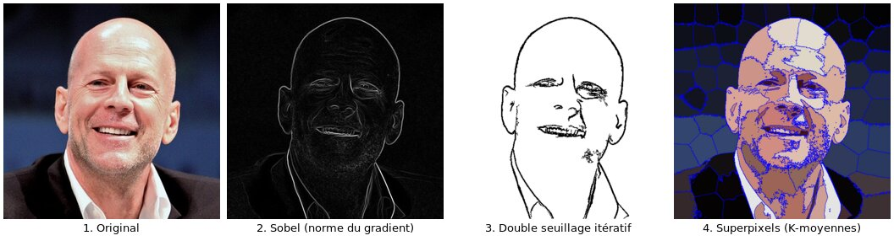

# Projet Image : traitement d'images en C++ sans bibliothèque

> Bibliothèque de traitement d'images écrite en C++ « à la main » : détection de contours (Sobel, seuillage par hystérésis) et segmentation en superpixels par K-moyennes. Les formats PBM, PGM et PPM sont lus et écrits par notre propre code.



*Ces quatre images sont des sorties réelles du programme, obtenues avec `make tests`.*

## Contexte

- **Cours** : Info 111, Programmation impérative, L1 double licence Informatique–Mathématiques (LDD IM), Université Paris-Saclay.
- **Date** : décembre 2023.
- **Travail en binôme** : Carlos Clement et Sergiu Mardare.
- **Cadre** : projet guidé. L'équipe enseignante fournissait le sujet, le squelette des fichiers (en-têtes, `Makefile`, tests de base), les images d'exemple, l'outil d'affichage `open_ppm.py` et la fonction `FAST_KMoyenne`. Les implémentations des fonctions sont les nôtres.

## Ce que fait le projet

Le projet suit 6 parties progressives. Toutes ont été réalisées.

| Partie | Contenu | Fichiers |
|---|---|---|
| 1. Images noir et blanc | Lecture et écriture PBM, affichage ASCII, inversion | `pbm-affiche.cpp`, `pbm-tout-en-un.cpp` |
| 2. Niveaux de gris | Lecture et écriture PGM, inversion | `pgm.cpp`, `pgm-tout-en-un.cpp` |
| 3. Contours | Filtre de Sobel, renormalisation, seuillage, double seuillage simple et itératif | `sobel.cpp`, `seuillage.cpp` |
| 4. Bibliothèque | Restructuration en modules (compilation séparée), programme en ligne de commande `TIN` | `*.hpp`, `Makefile`, `TIN.cpp` |
| 5. Couleur | Lecture et écriture PPM, conversion couleur ↔ gris | `ppm.cpp`, `gris-couleurs.cpp` |
| 6. Superpixels | Segmentation en régions par K-moyennes, tracé des frontières | `superpixel.cpp` |

## Techniques et mathématiques

- **Filtre de Sobel** : convolution par deux noyaux 3×3 qui estiment les dérivées partielles horizontale et verticale G<sub>x</sub> et G<sub>y</sub>. L'intensité du contour est la norme du gradient √(G<sub>x</sub>² + G<sub>y</sub>²). Les bords de l'image sont mis à 0.
- **Renormalisation** : remise à l'échelle linéaire dans [0, 255] par le maximum de l'image. Dans notre représentation, la première ligne de chaque `ImageGris` stocke la valeur maximale. Cela permet de normaliser par le vrai maximum calculé, ce qui donne une image de contours moins bruitée que la correction fournie.
- **Seuillage simple puis double seuillage (hystérésis)** : on part des pixels au-dessus d'un seuil fort, puis on étend itérativement aux pixels voisins (8-connexité) qui dépassent un seuil faible.
- **Luminance** : passage couleur → gris par Y = 0.2126 R + 0.7152 G + 0.0722 B.
- **Superpixels / K-moyennes** : chaque pixel devient un point de ℝ⁵, (i, j, λR, λG, λB). λ pondère la couleur par rapport à la position. Des pivots sont placés sur une grille de pas μ, puis l'algorithme alterne deux étapes : affectation de chaque point au pivot le plus proche (distance euclidienne) et recalcul de chaque pivot comme barycentre de sa classe. Chaque pixel prend ensuite la couleur de son pivot, et les frontières entre régions sont tracées en bleu, y compris sur les bords de l'image.

## Lancer le projet

Prérequis : un compilateur C++11 (`clang++` par défaut dans le `Makefile`) et **ImageMagick** (`convert`), qui convertit les JPEG en PGM/PPM texte.

```bash
make images                # convertit images/*.jpg en .pgm et .ppm
mkdir -p gris-couleurs ppm # dossiers de sortie absents du dépôt d'origine (voir Limites)
make all                   # compile les programmes et les tests
make tests                 # lance tous les tests et écrit les images résultats
```

Les images produites sont écrites dans `sobel/`, `seuillage/`, `seuillage_double/`, `superpixel/`, etc. Le test superpixel prend environ 15 s.

Pour visualiser une sortie (PGM/PPM → PNG) :

```bash
convert superpixel/Willis.512.ppm superpixel-willis.png
```

### Programme en ligne de commande `TIN`

```bash
./TIN -g images/Willis.512.ppm gris.pgm       # couleur -> niveaux de gris
./TIN -s images/Willis.512.pgm contours.pgm   # filtre de Sobel
./TIN -e images/Willis.512.pgm seuil.pgm      # seuillage
./TIN -p images/Willis.512.ppm superpix.ppm   # superpixels
```

## Ma contribution

Le projet a été fait **à deux, en binôme**, sur environ 30 h de travail commun : séances à la bibliothèque universitaire, code projeté sur un écran, problèmes décomposés au tableau (surtout pour les parties 3 et 6). Dans le code, la plupart des fonctions sont annotées « Auteur : nous 2 », sauf la lecture et l'écriture PBM de la partie 1, écrites par Sergiu. Le travail sur Sobel, le seuillage, les modules, la couleur et les superpixels est donc **une réalisation commune**.

## Limites connues

Le projet est publié tel qu'il a été rendu en 2023. Les défauts ci-dessous sont documentés plutôt que corrigés. Aucun n'empêche le projet de compiler ni les tests de passer.

- **`CouleurAuGris`** ne produit pas la ligne de « valeur max » de notre représentation. Après `ecrirePGM`, l'image grise perd une ligne (512×511) et son en-tête porte un maximum incorrect, d'où un rendu trop clair.
- **`TIN -d`** (double seuillage) s'arrête sur une exception : le programme passe un seuil fort de 500, alors que la fonction n'accepte que [0, 255]. De plus, l'aide (`-h`) intervertit `-s` et `-e` et mentionne des options `-c/-o` qui ne sont pas utilisées (les fichiers sont passés en arguments positionnels).
- **Dossiers `gris-couleurs/` et `ppm/`** absents : sans le `mkdir` ci-dessus, les tests correspondants n'écrivent rien, sans message d'erreur.
- **`KMoyenne`** (notre version naïve) ne met pas à jour les centres entre deux itérations, ce qui revient à une seule itération. Le filtre superpixel utilise la version optimisée `FAST_KMoyenne` fournie par les enseignants, donc les images ne sont pas affectées.
- Les lecteurs PBM, PGM et PPM ne gèrent pas les commentaires (`#`) dans les fichiers.

## Structure

```
.
├── image.hpp, image-test.hpp     types Image / ImageGris / ImageNB, données de test
├── pgm.*, ppm.*                  entrées/sorties
├── sobel.*, seuillage.*          contours
├── gris-couleurs.*               conversions
├── superpixel.*                  K-moyennes et superpixels
├── *-test.cpp                    programmes de test
├── *-tout-en-un.cpp              premières versions mono-fichier (parties 1 à 3)
├── TIN.cpp, renormalise.cpp      programmes en ligne de commande
├── images/                       images d'entrée fournies par le cours
├── rapport.md                    rapport d'origine (notebook Jupyter/MyST)
└── docs/exemples.jpg             capture du README
```

`rapport.md` est le rapport rendu à l'époque. Certaines de ses cellules font référence à des fichiers du cours (sujet, corrigés) qui ne sont pas inclus dans ce dépôt.

## Crédits

Sujet, squelette, images d'exemple, `open_ppm.py` et `FAST_KMoyenne` : équipe enseignante d'Info 111, Université Paris-Saclay. Les images restent la propriété de leurs auteurs respectifs.
